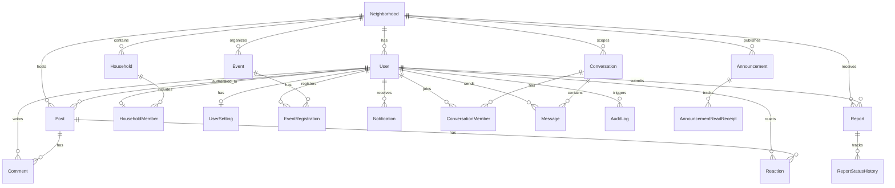

# THIẾT KẾ LẠI CƠ SỞ DỮ LIỆU (DATABASE DESIGN)
## SMART NEIGHBORHOOD – POSTGRESQL + PRISMA ORM (6 MODULE)

---

## 1. NGUYÊN TẮC THIẾT KẾ & TÁCH DỮ LIỆU ĐA TỔ DÂN PHỐ (MULTI-TENANT)

1. **Loại bỏ hoàn toàn nhóm bảng Tài chính cũ:** Gỡ bỏ `FundCampaign`, `ContributionRecord`, `ExpenseRecord` và các enum `FundType`, `PaymentStatus`, `PaymentMethod`.
2. **Multi-tenant Isolation:** Mọi thực thể nghiệp vụ (`User`, `Household`, `Post`, `Report`, `Announcement`, `Event`, `Conversation`, `CommunityPlace`) đều gắn khóa ngoại `neighborhoodId` (trỏ tới `Neighborhood`). Mọi truy vấn ở tầng Repository bắt buộc lọc theo `neighborhoodId` của người dùng hiện tại (ngoại trừ `SuperAdmin` có phạm vi liên tổ).
3. **Soft Delete & Audit:** Các bảng dữ liệu quan trọng (`User`, `Household`, `HouseholdMember`, `Post`, `Report`, `Announcement`, `Event`, `Message`) sử dụng trường `deletedAt DateTime?` kết hợp `createdAt`, `updatedAt`.

---

## 2. SƠ ĐỒ QUAN HỆ THỰC THỂ (ERD OVERVIEW)

---

## 3. ĐẶC TẢ CÁC BẢNG DỮ LIỆU CHI TIẾT (20 BẢNG)

### Nhóm A: Hệ thống, Phân quyền & Đa tổ (Core & RBAC)
1. **`Neighborhood` (`neighborhoods`)**:
   - `id (UUID PK)`, `code (unique)`, `name`, `ward`, `district`, `city`, `boundaryGeoJson (Json?)`, `isActive`, `createdAt`, `updatedAt`.
2. **`User` (`users`)**:
   - `id (UUID PK)`, `neighborhoodId (FK)`, `phoneNumber (unique)`, `email (unique?)`, `passwordHash`, `fullName`, `avatarUrl`, `role (Enum: SUPER_ADMIN, LEADER, STAFF, RESIDENT)`, `status (ACTIVE, INACTIVE, DELETION_REQUESTED)`, `refreshTokenHash`, `deletedAt`, `createdAt`, `updatedAt`.
   - *Index:* `(neighborhoodId, role)`, `(phoneNumber)`.
3. **`UserSetting` (`user_settings`)** *(Module 6)*:
   - `id (UUID PK)`, `userId (FK unique)`, `pushAnnouncements (Bool)`, `pushEvents (Bool)`, `pushReports (Bool)`, `pushMessages (Bool)`, `allowDirectMessage (Enum: EVERYONE, NEIGHBORHOOD_ONLY, OFFICERS_ONLY)`, `showPhoneNumber (Bool)`, `updatedAt`.
4. **`AccountDeletionRequest` (`account_deletion_requests`)** *(Module 6)*:
   - `id (UUID PK)`, `userId (FK)`, `reason`, `status (PENDING, APPROVED, REJECTED)`, `reviewedBy`, `reviewedAt`, `createdAt`.
5. **`AuditLog` (`audit_logs`)**:
   - `id (UUID PK)`, `neighborhoodId (FK?)`, `actorId (FK?)`, `action`, `resource`, `resourceId`, `oldData (Json?)`, `newData (Json?)`, `ipAddress`, `createdAt`.
   - *Index:* `(neighborhoodId, createdAt DESC)`, `(actorId, action)`.

### Nhóm B: Quản lý Cư dân (Module 3)
6. **`Household` (`households`)**:
   - `id (UUID PK)`, `neighborhoodId (FK)`, `code (unique per neighborhood: @@unique([neighborhoodId, code]))`, `houseNumber`, `street`, `addressDetail`, `latitude`, `longitude`, `deletedAt`, `createdAt`, `updatedAt`.
7. **`HouseholdMember` (`household_members`)**:
   - `id (UUID PK)`, `householdId (FK)`, `userId (FK unique?)`, `fullName`, `cccdNumber (unique?)`, `dateOfBirth`, `gender`, `isHead (Bool)`, `relationToHead (Enum)`, `residenceType (THUONG_TRU, TAM_TRU, TAM_VANG, LUU_TRU)`, `residenceStatus (DANG_CU_TRU, TAM_VANG, DA_CHUYEN_DI)`, `expiredAt (DateTime?)`, `deletedAt`, `createdAt`, `updatedAt`.
   - *Constraint & Index:* `(householdId, isHead)`, `(cccdNumber)`, `(householdId, residenceStatus)`.

### Nhóm C: Bảng tin, Bình luận & Phản ánh sự cố (Module 1 & Module 4)
8. **`Post` (`posts`)**:
   - `id (UUID PK)`, `neighborhoodId (FK)`, `authorId (FK)`, `category (LIFE, WARNING, EVENT_RECAP)`, `visibility (PUBLIC, OFFICERS_ONLY)`, `title?`, `content`, `isPinned (Bool)`, `isOfficial (Bool)`, `deletedAt`, `createdAt`, `updatedAt`.
   - *Index:* `(neighborhoodId, isPinned DESC, createdAt DESC)`.
9. **`Comment` (`comments`)**:
   - `id (UUID PK)`, `postId (FK)`, `authorId (FK)`, `parentId (FK? - reply)`, `content`, `deletedAt`, `createdAt`, `updatedAt`.
   - *Index:* `(postId, createdAt)`.
10. **`Reaction` (`reactions`)**:
    - `id (UUID PK)`, `postId (FK)`, `userId (FK)`, `type (LIKE, HEART, CLAP)`, `createdAt`.
    - *Unique:* `@@unique([postId, userId])`.
11. **`Report` (`reports`)** *(Phản ánh sự cố - hiển thị ở Module 1 & Bản đồ Module 4)*:
    - `id (UUID PK)`, `neighborhoodId (FK)`, `reporterId (FK)`, `assignedToId (FK?)`, `category (INFRASTRUCTURE, SANITATION, SECURITY, LIGHTING, OTHER)`, `visibility (PUBLIC, PRIVATE)`, `title`, `description`, `status (PENDING, IN_PROGRESS, RESOLVED, REJECTED)`, `latitude (Float?)`, `longitude (Float?)`, `addressText`, `deletedAt`, `createdAt`, `updatedAt`.
    - *Lưu ý bảo mật:* Khi `visibility = PRIVATE`, API Bản đồ không trả về; khi `visibility = PUBLIC`, API Bản đồ lọc bỏ `reporterId` / thông tin người gửi.
    - *Index:* `(neighborhoodId, visibility, status, createdAt DESC)`.
12. **`ReportStatusHistory` (`report_status_histories`)**:
    - `id (UUID PK)`, `reportId (FK)`, `changedById (FK)`, `fromStatus`, `toStatus`, `note`, `createdAt`.

### Nhóm D: Thông báo & Sự kiện (Module 2)
13. **`Announcement` (`announcements`)**:
    - `id (UUID PK)`, `neighborhoodId (FK)`, `authorId (FK)`, `title`, `content`, `priority (NORMAL, IMPORTANT, URGENT)`, `isPinned (Bool)`, `publishedAt`, `deletedAt`, `createdAt`, `updatedAt`.
    - *Index:* `(neighborhoodId, isPinned DESC, publishedAt DESC)`.
14. **`AnnouncementReadReceipt` (`announcement_read_receipts`)**:
    - `id (UUID PK)`, `announcementId (FK)`, `userId (FK)`, `readAt`.
    - *Unique:* `@@unique([announcementId, userId])`.
15. **`Event` (`events`)**:
    - `id (UUID PK)`, `neighborhoodId (FK)`, `organizerId (FK)`, `title`, `description`, `locationName`, `latitude`, `longitude`, `startTime`, `endTime`, `maxAttendees?`, `status (UPCOMING, ONGOING, COMPLETED, CANCELLED)`, `deletedAt`, `createdAt`, `updatedAt`.
    - *Index:* `(neighborhoodId, startTime)`.
16. **`EventRegistration` (`event_registrations`)**:
    - `id (UUID PK)`, `eventId (FK)`, `userId (FK)`, `status (REGISTERED, CANCELLED, ATTENDED)`, `registeredAt`, `updatedAt`.
    - *Unique:* `@@unique([eventId, userId])`.
17. **`Notification` (`notifications`)** & **`DeviceToken` (`device_tokens`)**:
    - Lưu lịch sử thông báo đẩy theo từng user (`type`, `title`, `body`, `referenceId`, `isRead`, `createdAt`) và token FCM/Expo theo thiết bị.

### Nhóm E: Kết nối cộng đồng & Tệp đính kèm (Module 5 & Chung)
18. **`Conversation` (`conversations`)**:
    - `id (UUID PK)`, `neighborhoodId (FK)`, `type (DIRECT, GROUP, SUPPORT)`, `name?`, `createdById (FK)`, `lastMessageAt`, `createdAt`, `updatedAt`.
19. **`ConversationMember` (`conversation_members`)**:
    - `id (UUID PK)`, `conversationId (FK)`, `userId (FK)`, `memberRole (ADMIN, MEMBER)`, `lastReadAt`, `isMuted`, `joinedAt`.
    - *Unique:* `@@unique([conversationId, userId])`.
20. **`Message` (`messages`)** & **`MessageReport` (`message_reports`)**:
    - `Message`: `id`, `conversationId`, `senderId`, `content`, `isModerated (Bool)`, `deletedAt`, `createdAt`.
    - `MessageReport`: `id`, `messageId`, `reporterId`, `reason`, `status (PENDING, REVIEWED, DISMISSED)`, `reviewedById?`, `createdAt`.
21. **`Attachment` (`attachments`)** *(Dùng chung cho Post, Report, Announcement, Message)*:
    - `id (UUID PK)`, `uploaderId (FK)`, `entityType (POST, REPORT, ANNOUNCEMENT, MESSAGE)`, `entityId`, `url`, `mimeType`, `fileSize`, `fileName`, `createdAt`.
    - *Index:* `(entityType, entityId)`.

---

## 4. CHIẾN LƯỢC MIGRATION AN TOÀN

Hiện tại thư mục `apps/backend/prisma/migrations/` chưa có file migration nào được chạy lên PostgreSQL thực tế. Tuy nhiên để đảm bảo an toàn:
1. **Kiểm tra trạng thái DB trước khi sửa schema:** Chạy `prisma migrate status` (nếu đã từng deploy ở môi trường khác).
2. **Nếu DB chưa từng migrate (Greenfield):** Cập nhật `schema.prisma` theo 6 module mới, xóa sạch model tài chính, sau đó chạy `npx prisma migrate dev --name restructure_6_modules`.
3. **Nếu DB đã có dữ liệu bảng `fund_campaigns` / `contribution_records` / `expense_records`:** Không chạy `DROP TABLE` trực tiếp trong 1 bước. Thực hiện 2 pha:
   - *Pha 1:* Ngừng ghi dữ liệu vào 3 bảng tài chính ở tầng code, backup dữ liệu ra file `.sql` (`pg_dump -t fund_campaigns -t contribution_records -t expense_records`).
   - *Pha 2:* Tạo migration tách biệt (`drop_finance_tables`) chỉ chạy sau khi đã xác nhận bản sao lưu an toàn.

